# River profile card

Your last 12 months on GitHub, drawn as a **river** — inside a status-page card for your profile README.

The river rises at its source a year ago and reaches its mouth this week. **Its width at every bend is the number of contributions you made that week.** Around it: a status header, four tiles and your active days from the last 90 days. Light and dark themes, animated, refreshed daily by a GitHub Action.

<picture>
  <source media="(prefers-color-scheme: dark)" srcset="./examples/wisla-dark.svg">
  <source media="(prefers-color-scheme: light)" srcset="./examples/wisla-light.svg">
  
</picture>

## Pick your river

| `river` | River | Country | |
|---|---|---|---|
| `wisla` | Wisła | 🇵🇱 Poland | [preview](./examples/wisla-light.svg) |
| `rhein` | Rhein | 🇩🇪 Germany | [preview](./examples/rhein-light.svg) |
| `loire` | Loire | 🇫🇷 France | [preview](./examples/loire-light.svg) |
| `thames` | Thames | 🇬🇧 United Kingdom | [preview](./examples/thames-light.svg) |
| `po` | Po | 🇮🇹 Italy | [preview](./examples/po-light.svg) |
| `vltava` | Vltava | 🇨🇿 Czechia | [preview](./examples/vltava-light.svg) |
| `mississippi` | Mississippi | 🇺🇸 United States | [preview](./examples/mississippi-light.svg) |
| `nile` | Nile | 🇪🇬 Egypt | [preview](./examples/nile-light.svg) |

Missing your river? Open an issue — adding one is a short entry in [`src/presets.ts`](./src/presets.ts).

## Quick start

1. Open your profile repository — the public repo named exactly like your login (`<you>/<you>`). Create it if you don't have one.
2. Add `.github/workflows/river-card.yml`:

```yaml
name: River card
on:
  schedule:
    - cron: '17 4 * * *'   # every day
  workflow_dispatch:
permissions:
  contents: write
jobs:
  card:
    runs-on: ubuntu-latest
    steps:
      - uses: actions/checkout@v4
      - uses: amrozu/river-card@v1
        with:
          river: wisla
          name: Jan Kowalski
          role: Senior Developer
          company: ACME        # optional
          city: Kraków         # optional; known cities get a dot on the map
```

3. Run it once from the **Actions** tab (*Run workflow*). It commits `river-card/river-light.svg` and `river-card/river-dark.svg`.
4. Put the card in your `README.md`:

```html
<picture>
  <source media="(prefers-color-scheme: dark)" srcset="./river-card/river-dark.svg">
  <source media="(prefers-color-scheme: light)" srcset="./river-card/river-light.svg">
  
</picture>
```

## Inputs

| Input | Default | |
|---|---|---|
| `name` | — (required) | Full name in the header |
| `river` | `wisla` | One of the rivers above |
| `role` | `Developer` | First tile |
| `company` | empty | Shown under the role |
| `city` | empty | Header; marked on the map if it is a known city there (local or English spelling) |
| `github_user` | repository owner | Whose contributions are drawn |
| `output_dir` | `river-card` | Where the SVGs go |
| `commit` | `true` | Commit and push when the card changes |

## How it works

- Contributions come from your **public contribution calendar** — no token or extra permissions. To include private work, enable *Contribution settings → Private contributions* on your profile.
- The card is plain animated SVG (CSS only, no scripts), so it renders inside GitHub READMEs. Visitors with *reduced motion* see the finished picture.
- Labels (cities, months, source, mouth, busiest week) are placed automatically so they don't collide with each other or the river.
- Zero dependencies: TypeScript run directly by Node 24.

Run it locally:

```bash
node src/cli.ts --user <login> --name "Your Name" --role "Developer" --river rhein --city Köln --out out
```

## Credits

Map data: [Natural Earth](https://www.naturalearthdata.com/) (public domain). Code: MIT © Łukasz Amroz.
